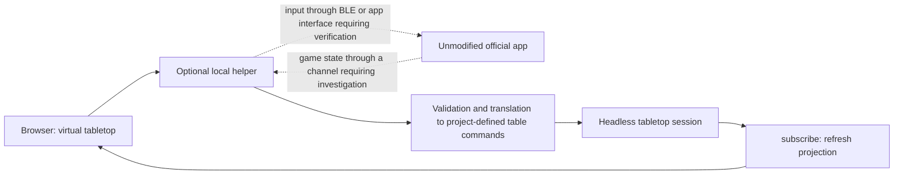

# Preliminary research: link official app to the virtual table

Date: October 22, 2026. Goal: A playable session with the unmodified official Milan app, without physical board game components. The app remains the authority for rules, story, dice outcomes and campaign. This research provides a preferred direction and concrete verification steps; no working link yet.

## Advice

Investigate an **optional native Windows helper with two separate connections**: input from our table to the official app, and game state/instructions from the app back to our table. A BLE peripheral/GATT route is the most targeted technical candidate for Core entry. Automatic placement of influence also requires a source of app state; for this purpose, a useful network/controller channel is preferred over image recognition.

This is an architectural choice based on the components found and available Windows APIs, not a proven compatible solution. Check the normal app flow first: if it already provides usable manual input, that's the shortest route. Manufacturer contact and an SDK request are not a prerequisite for the local verifications described here.

A BLE connection alone does not make the project playable. We must also demonstrate session start, valid character selection/registration, location entry, contact release, and resume. Core output does not need to contain influence numbers: they belong to the game state of the app and must be found separately.

## Which has now been established

| Finding | Evidence | Meaning and limitation |
| --- | --- | --- |
| According to the hardware documentation, the app communicates with the Core via BLE. | [Xplored Hardware](https://teburu.zendesk.com/hc/en-us/articles/25458765821979-Teburu-Hardware) | A virtual Core should behave on the peripheral/server side. The message contract is still missing. |
| The Windows installation names `Teburu.dll`, `Starbox.BLE.dll`, `Starbox.Network.dll`, `Starbox.Networking.dll` and `Unity.WebRTC.dll` in `ScriptingAssemblies.json`. The native BLE and WebRTC DLLs are present. | Windows 1.0.9 local manifest, read only; fingerprints in the private report. | Both hardware and network communications are serious research avenues. A dependency does not prove a public API or actual use in a specific flow. |
| There are 45 files `Location_*.json` under `StreamingAssets/MapsOffsets/Milan`. | Only file names counted and a limited structure check, no configuration copied. | Note for existing presentation configuration. The format and meaning have not been validated; the numbers are not proven sensor or district mapping. |
| Windows provides GATT server APIs and a capability query for peripheral support. | [Microsoft GATT Server](https://learn.microsoft.com/en-us/windows/apps/develop/devices-sensors/gatt-server), [BluetoothAdapter.IsPeripheralRoleSupported](https://learn.microsoft.com/en-us/uwp/api/windows.devices.bluetooth.bluetoothadapter.isperipheralrolesupported) | Native helper is technically researchable. The own adapter outcome and hardware observations remain exclusively under `private/integration/`. No service advertised or connected. |
| Official remote participation exists, but the setup described has a physical Teburu host. | [Official FAQ](https://www.teburu.com/faq/) | Remote is not a proven replacement for the Core, but it is a possible channel for app interaction. |
| Digital throws are in the Milan version history. | [App Store Publisher's Notes](https://apps.apple.com/us/app/teburu-vampire-the-masquerade/id6739258011) | The dice radio probably doesn't need to be reproduced first. Windows operation and access without Core remain to be tested. |

The installation also includes USB and deep link library names. These are not proof that the Core accepts game input via USB or that deep links support game commands. There is no reason to base an adapter on that now.

## Comparison of options

| Itinerary | To the app | To our table | Priority |
| --- | --- | --- | --- |
| Normal manual app control | Only if the existing UI offers it | First manually, possibly later via an observed state source | First test briefly; fastest way to determine the real blockage. Not publicly documented as boardless mode. |
| Native helper as BLE peripheral | Candidate for identity/sensor entry, subject to valid protocol and registration path | Only what the app actually sends via this connection | Main technical research track for physical input replacement. Unknown handshake, allowed logical identities, and location meaning are the biggest gaps. |
| Existing network/controller route | Possible, but no external import contract described yet | Possible full or partial game synchronization | Parallel research; dependency and remote functionality make this a starting point. Without a virtual host, the physical host requirement remains. |
| Only read own logs/saves | No common entry route | Only if the relevant condition is actually present and available on time | Cheap next step after normal starting. The FAQ mentions local SaveGames; log/save format and update times have not been determined. Never modify saves as an input trick. |
| Window Capture + OCR/Image Recognition | No Core input; possibly normal UI controls separately | Candidacy for visible assignments such as placing influence | Fallback route for outbound automation. First present unclear recognition for checking. Cannot resolve hardware blockage. |
| Official SDK | Unproven for existing apps | Unproven for existing apps | Parallel documentation route. The [request page](https://www.teburu.com/request-sdk/) focuses on private amateur games; no application made or agreement accepted. |

An Android emulator runs the Android app, but does not replace the Core and registration/sensor protocol. Follow-up research has found a concrete possible advantage: Netsim/Bumble can connect a separate virtual Bluetooth core on the same PC to Android, without physical radio loopback. This has not yet been tested with Milan. See [replace or use tablet differently](TABLET-ALTERNATIVES.md).

## Why the browser can't be the whole bridge

The documented [Web Bluetooth Route](https://developer.chrome.com/docs/capabilities/bluetooth) allows a website like Central to connect to a remote GATT server. That is the other side of the connection than a virtual Core that must be found by the official app. Our browser table remains the UI; an optional native helper handles any platform functions.

Windows offers `GattServiceProvider`, but reserves DIS/GAP/GATT services and limits ads, among other things. If the core profile actually required is stuck on this, another peripheral implementation should be investigated. Peripheral capability also proves no connection between two processes on the same PC/radio. A generic proprietary GATT test must first test the intended device setup. Nothing has been advertised, paired or connected yet.

Unity documents [WebRTC DataChannel](https://docs.unity3d.com/Packages/com.unity.webrtc@3.0/manual/datachannel.html) for messages between peers. That makes the dependency found interesting, but doesn't give us a Teburu signaling, session or message schema. Don't assume that any WebSocket or DataChannel can talk to the app.

For the OCR fallback route, there are [Windows Window Capture](https://learn.microsoft.com/en-us/windows/apps/develop/media-authoring-processing/screen-capture) and [OcrEngine](https://learn.microsoft.com/en-us/uwp/api/windows.media.ocr.ocrengine?view=winrt-26100). Both are platform building blocks; recognition of Milan screens has not yet been tested.

## Intended data flow

The diagram below is a design, not an existing connection:



The existing session can already be automatically redrawn after commands from other code. A future influence update should reflect this: validate location and faction, distinguish between target state and quantity to add, respect available physical inventory, change only relevant parts, and apply the entire change as one recoverable action. A second reception of the same message may not create additional cubes. After reconnection, a confirmed state synchronization is required.

Our current `table.arrange` is a complete setup. Do not use it with influence only if it will delete other pieces. A targeted atomic update or a complete setup carefully constructed from the current state must first be specified and tested. These custom table commands are not Teburu messages.

## Concrete next steps and decision moments

1. **Record normal setup flow.** Launch the official app in a separate test session, follow Main/One Device/Controller/Remote as provided and note the exact point at which Core or miniatures are needed. Do not use hidden mode. The existing protocol is in [APP-VALIDATION.md](APP-VALIDATION.md); this has not yet been implemented.
2. **Native transport loose proof.** The read-only capability probe is available. Next experiment: its own generic GATT service with its own test client, without Teburu identity, to test advertising, connection, write/notify and the device setup. Only the transport layer proves this; not yet implemented.
3. **Substantiate actual input contract.** Use public specifications or own permitted observations to determine service profile, session start, character significance, location/contact, and time sequence. Only keep your own identifiers private. If a security bypass or cloned tag identity is required, then that route is not a deployment path for this project.
4. **Prove feedback separately.** Once a normal session is reachable, compare one visible influence change with available own logs/saves or a usable communication channel. [Unity log documentation](https://docs.unity3d.com/6000.1/Documentation/Manual/log-files.html) only gives the general location, not a Milan state diagram. In the absence of machine-readable output: first test a local capture/OCR with a concrete app screen.
5. **One full playthrough.** Start campaign, select/register four characters, make a valid move, use an official digital roll, process one real city influence instruction automatically, and resume consistently after exit. Only when this works reproducibly without physical game components will we have a playable linked situation.

Independent next steps 1–4 can be performed without manufacturer contact where the necessary normal app flow or own observations are available. The lack of protocol information is a concrete technical uncertainty, not a reason to invent rules or messages.

## Reproducible local probe

```powershell
powershell.exe -NoProfile -File tools/check-bridge-prerequisites.ps1
```

The probe reads selected installation manifests, counts deployment files, stores hashes, checks only for the existence of expected runtime paths, and queries the capabilities of the standard Bluetooth adapter. No peer scan, device names, addresses, RFID identities, save/log contents, or network traffic. No app launch, installation, modification or hardware connection.

The report is listed under ignored `private/integration/prerequisites.json`. Only the tool and this analysis go to GitHub. The demo remains Node-only; the helper is not yet built and will be optional later.

## Search for existing deployments

Public searches on Teburu + BLE/protocol/emulator/SDK and a GitHub repository search on `teburu` and `teburu xplored` did not return a verified Milan/Core emulator within this check. A controlled namesake, [BigJk/teburu](https://github.com/BigJk/teburu), is a spreadsheet API. This is not proof that relevant implementations do not exist anywhere. No SDK or code from an unknown emulator is installed.


## Status update: SDK available locally

On October 22, 2026, the user made an SDK archive available locally. Intake and initial static assessment were performed under ignored `private/sdk/`. The additional technical findings and test prioritization remain there; no confidential SDK content is published. Previous passages on missing SDK access describe the preliminary research phase. No SDK code, messages, or configurations added to the public deployment. Official app compatibility remains unproven.
